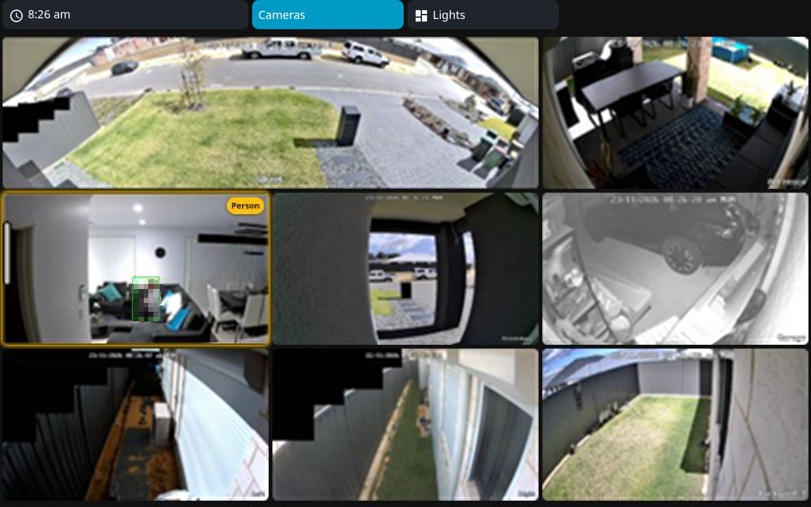

# Echo Show HTML Dash

## Why we built it

This project began with cameras. Existing Home Assistant camera cards did not work reliably on our Echo Show: feeds had connection problems, and the camera wall was difficult to use on its small screen. We wanted a camera view designed for the Echo, where we could choose the feeds, control their size and refresh, and tap a tile to open the Echo's native camera viewer.

That camera view grew into a dashboard builder. A single, editable **Echo Show Dash HTML Builder** holds named Dash setups. You can put cameras, lights, temperatures, and existing Lovelace cards into menus, add controls to the top bar, and choose whether content fits the screen or scrolls below the menu. Save a setup in the builder, then apply it to a selected Echo. Applying it creates or replaces that Echo's dashboard; the builder remains available for later changes.

## How it works

1. Open the builder on a computer and create or select a named Dash.
2. Choose its menus, camera feeds, controls, and screen layout. Save the setup for later use.
3. Select an Echo and apply the Dash. Changes to a saved setup reach the Echo only when you apply it again.

For the controls and illustrated steps, see the [user guide](docs/USER_GUIDE.md).

## What you need

- **Home Assistant** with the dashboard's JavaScript resource installed. The repository declares Home Assistant 2024.12.0 as its minimum version; that is metadata, not a verified compatibility range.
- **A TECHO5 Echo Show connected to Home Assistant** to assign a Dash to a device and open its native camera viewer from a camera tile. Camera menus also need camera entities available in Home Assistant.
- **Dashcast for Streamed presentation.** It renders the Home Assistant dashboard for the Echo, including custom Lovelace cards. TECHO5's Drawn presentation does not render this project's custom cards as designed. See [TECHO5's dashboard guide](https://github.com/HuskerMinion/techo5/blob/main/docs/dashboards.md).
- **Any optional custom Lovelace cards** you select in the builder must already be installed and working in Home Assistant.

Node.js and the packages in `package.json` are needed only by a developer building the JavaScript from source. They are not runtime dependencies on the Echo.

## Installation status

This repository currently contains the source code, not a ready-to-install release. The [user guide](docs/USER_GUIDE.md) starts once the builder is already set up in Home Assistant. A complete first-time installation guide and automatic builder creation are still needed; registering the JavaScript file alone does not create the builder dashboard.

The previous build commands were for developers working on the source, not steps an everyday user should have to follow. They are now in [developer setup](docs/DEVELOPER_SETUP.md).
