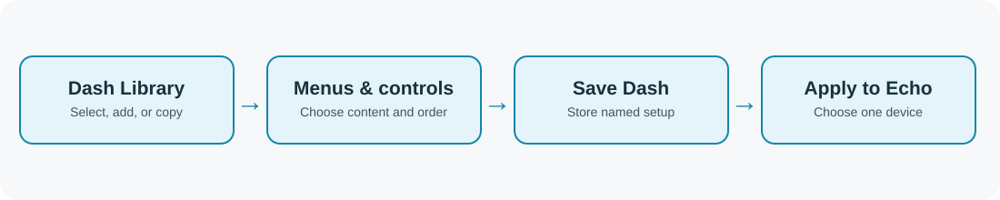
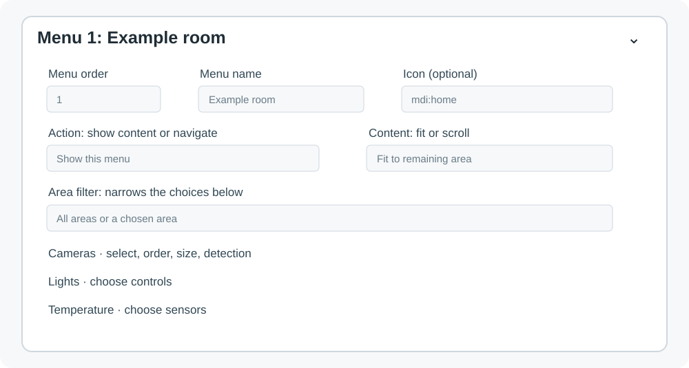
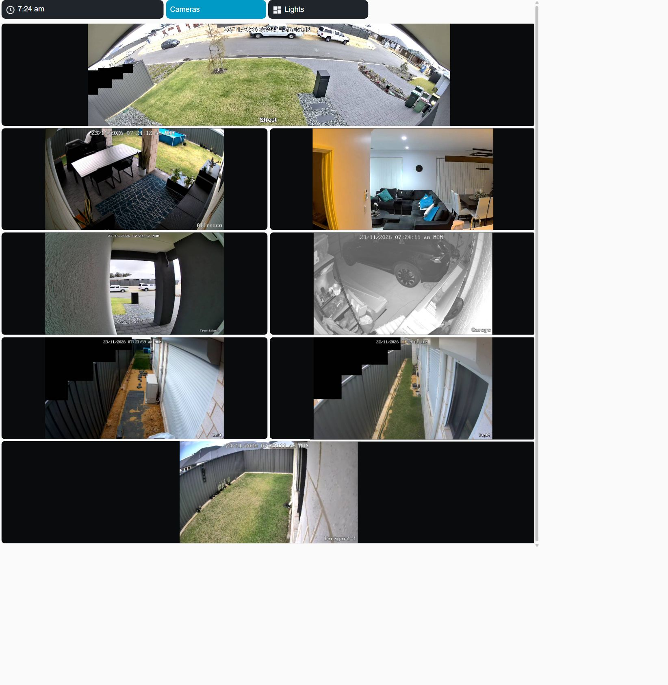

# Echo Show HTML Dash — user guide

The **Echo Show Dash HTML Builder** is the editable master dashboard. It stores named Dash setups. Applying one creates a dashboard for the selected Echo; editing the saved setup later does not change that Echo until you apply it again.

The control pictures are diagrams, so they contain no private Home Assistant sidebar or entity names. The Show 8 camera view below is a real example shared with permission; your devices and layout will differ.

## 1. Choose or create a Dash

1. Open Home Assistant on a computer and select **Echo Show Dash HTML Builder**.
2. Under **Dash Library**, choose a saved **Dash name** to load its settings.
3. Press **Add Dash** for a blank setup, or **Copy Dash** to start with the selected Dash's settings. Give it a unique name when prompted. Names are permanent keys; make a copy if you need a different name.
4. **Delete Dash** removes a saved setup from the library. Use it only when you no longer want to edit or apply that setup.

A saved Dash is a set of builder settings. It does not create a separate Home Assistant dashboard until applied to an Echo.

## 2. Set up menus

Open **Dashboard Content and Menus**. The first menu is **Cameras**. Press **Add menu** for another top-bar button. Expand a menu with its down arrow. Each menu has its own order, label, icon, action, and content.

1. Set **Menu order** and **Menu name**. Optionally choose an icon, its placement, and a state entity for a changing icon.
2. Set **Action** to **Show this menu** for local content or **Navigate to Dashboard** to open another local Home Assistant view. Choose the destination from the list.
3. For a content menu, set **Content below menu** to **Fit to remaining area** to scale into the screen below the fixed bar, or **Scrollable below menu** to keep the chosen content size and scroll that area.
4. Use **Area filter** to narrow the camera, light, and temperature lists while editing. It is only a selection aid; one menu can include devices from different areas.

### Cameras

Expand **Cameras** and tick the feeds to show. Each selected feed exposes **Camera size, order & overlay**. Set its sequence, tile width, name and position, refresh override, and detection entities there. **Detection styles** above the menus controls the shared animation and colour for types such as Person and Dog. Choose a real matching state or count entity for each camera.

The **Default camera image refresh** setting applies unless a camera has an override. Faster refresh requests more images and uses more network and server capacity. Tapping a supported tile asks the Echo's native camera viewer to open that feed.

### Lights, temperature, and cards

Expand **Choose lights** or **Temperature sensors**, then tick the entities for this menu. Light controls offer on/off and brightness where the light supports it. Temperature shows the sensor's value and unit. Cameras, lights, and temperature can share one menu.

Use **Custom Card Holder** to make existing Lovelace cards available. For a menu, choose **Lovelace Cards** as its button source, tick **Cards in this menu**, then set each chosen card's order, width, and height. Its native card actions remain available. If a source card is removed, correct its reference in the holder.

## 3. Add top-bar controls

**Menu-Bar Controls** applies to the selected Dash across its menus.

- **Status displays:** Add a clock or entity value such as temperature. Choose left/right placement, order, icon, alignment, and an optional tap action. The clock has 12-hour and 24-hour Perth formats.
- **Menu-bar toggles:** Enter the button text plus on/off text. Choose a state entity, a **Script toggle** or **Automation toggle**, and separate actions for turning on and off. Placement, order, icon, colours, confirmation, and hold-to-turn-off are optional. The state entity determines the displayed text and colour after an action.

## 4. Save and apply

Go to **Echo Assignment and Deployment** near the bottom.

1. Choose the destination **Echo Show**. Check the device name before applying.
2. Choose **Presentation**, **Dashboard when idle**, and **Kiosk on this Echo**. The kiosk choice affects the generated Echo dashboard, not the builder.
3. Press **Save Dash** to store the selected named setup for later. It does not change an Echo.
4. Press **Apply Dash to Echo** to save that setup, create or replace this Echo's builder-created dashboard, and attach it. The library copy remains available.

Editing a saved Dash does not silently update an Echo. Apply it again to replace the previous builder-created copy for that device. **Echo dashboards applied from this builder** lists current copies.

To assign an ordinary Home Assistant dashboard instead, expand **Apply a standard Home Assistant dashboard**, choose one, and press **Apply standard dashboard**. This uses that dashboard's path without changing its contents or adding a kiosk override.

## 5. Check the result

Open the applied dashboard and check its top buttons, content fit, and actions. This real Show 8 example has a clock, Cameras and Lights buttons, and a camera wall. These feeds are not defaults.

If the Echo still shows an old page, verify its selection and current assignment in the builder, then reload the Echo dashboard. Test navigation and controls on the intended device.

## Troubleshooting

| Symptom | Check |
| --- | --- |
| Empty menu | Confirm its button source and ticked entities or cards. |
| Stale camera image | Check the camera in Home Assistant and its refresh setting. |
| Toggle text or colour stays unchanged | Check that its state entity changes after the action. |
| Content is cut off | Try **Fit to remaining area** or **Scrollable below menu**. |
| Echo shows an earlier Dash | Verify the device selection, then apply the saved Dash again. |

For installation and builds, see the [README](../README.md) and [development deployment guide](PERMANENT_DEV_DEPLOYMENT.md).
